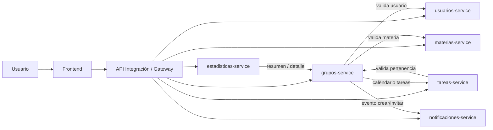
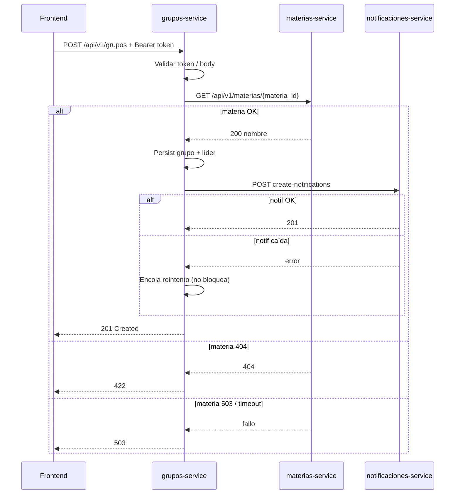

# ENTREGA #2  
## Diseño y construcción del sistema distribuido CampusStudy  
### Servicio asignado: **grupos-service**

**Asignatura:** Sistemas Distribuidos  
**Docente:** Claudia Andrea Vasquez Hernandez  
**Fecha:** Octubre 2026  

**Integrantes**

| Nombre | ID |
|--------|-----|
| Miguel Angel Beltran Rache | 1048977 |
| Alma Carina Hernandez Fernandez | 964358 |
| Samuel Orlando Caro Brahoma | — |

---

## 1. Descripción general de CampusStudy

### 1.1 Nombre del sistema
**CampusStudy** – Sistema distribuido de apoyo a la gestión académica estudiantil.

### 1.2 Descripción del sistema
**¿Qué es CampusStudy?**  
Plataforma distribuida que organiza la vida académica del estudiante: materias, grupos de trabajo, tareas, notificaciones, estadísticas y un frontend unificado.

**¿Qué necesidad atiende?**  
Centralizar la colaboración estudiantil (grupos, entregas, avisos e indicadores) sin depender de un único monolito, de modo que cada capacidad pueda evolucionar e integrarse de forma independiente.

**¿Quiénes son sus usuarios?**  
Estudiantes (miembros y líderes de grupo), docentes/coordinadores (visión académica) y servicios internos consumidores de datos (estadísticas, tareas, frontend).

**¿Qué funcionalidades ofrece?**  
Registro/autenticación, gestión de materias, creación y gestión de grupos, tareas individuales/grupales, notificaciones, indicadores académicos y punto de interacción web.

**¿Por qué se plantea como sistema distribuido?**  
Cada dominio (usuarios, materias, grupos, tareas, notificaciones, estadísticas) tiene ciclo de vida, carga y fallos distintos. Separarlos permite escalar, desplegar y fallar de forma aislada, comunicándose por red (REST/JSON) y presentándose al usuario como un sistema coherente.

**¿Qué servicios lo conforman?**

| Servicio | Responsabilidad |
|----------|-----------------|
| Usuarios y autenticación | Registro, autenticación y autorización |
| Materias | Gestión de materias |
| Grupos | Grupos de estudio/trabajo y herramientas colaborativas |
| Tareas | Actividades académicas individuales/grupales |
| Notificaciones | Avisos y eventos |
| Estadísticas | Indicadores académicos |
| API Integración | Orquestación / gateway |
| Front | Interfaz de usuario |
| Pruebas del sistema distribuido | Integración y validación transversal |

**¿Cómo se relacionan?**  
El frontend (vía API de integración o llamadas directas) consume los microservicios. **grupos-service** valida materias y usuarios, notifica eventos, expone detalle a tareas/estadísticas y enriquece el calendario con datos de tareas.

### 1.3 Planteamiento del problema
Los estudiantes necesitan coordinar trabajo por materia (integrantes, enlaces Zoom/Jam, documentos y fechas de entrega) sin perder trazabilidad ni depender de chats dispersos. La falta de un espacio estructurado genera desorganización, pérdida de archivos, falta de visibilidad de quién pertenece a qué grupo y dificultad para medir participación. Los afectados son estudiantes (principalmente) y docentes que requieren evidencia de trabajo colaborativo.

### 1.4 Objetivo general del sistema
Brindar una plataforma distribuida coherente que apoye la gestión académica estudiantil, permitiendo organizar materias, grupos, tareas y avisos de punta a punta.

### 1.5 Objetivos específicos
1. Permitir autenticación y gestión de usuarios académicos.  
2. Administrar materias y su asociación a grupos de trabajo.  
3. Gestionar grupos, integrantes y recursos colaborativos.  
4. Coordinar tareas individuales y grupales con fechas de entrega.  
5. Notificar eventos relevantes y exponer indicadores de actividad.

---

## 2. Alcance del sistema distribuido

### CampusStudy SÍ hace
- Gestión distribuida de usuarios, materias, grupos, tareas y notificaciones.  
- Comunicación REST/JSON entre servicios.  
- Experiencia unificada vía frontend.  
- Métricas básicas de actividad (estadísticas).

### CampusStudy NO hace
- Reemplazar el LMS institucional completo (notas oficiales, matrícula formal).  
- Almacenar binarios de documentos (solo registra URLs).  
- Videoconferencia propia (usa enlaces Zoom/Jam externos).  
- Garantizar consistencia fuerte global entre todos los servicios en todo momento (se diseñan políticas por servicio).

---

## 3. Arquitectura propuesta del sistema distribuido

> Diagrama general para Miro / documentación.



Cada servicio posee su propia base de datos lógica y se comunica por HTTP. El usuario percibe un solo sistema.

---

## 4. Descripción del servicio asignado

### 4.1 Nombre del servicio
**grupos-service**

### 4.2 Propósito
Administrar los grupos de trabajo organizados por materia, sus integrantes, herramientas colaborativas (Zoom, documentos Word/Excel, Calendario y Jam) y la trazabilidad de sus registros.

### 4.3 Problema particular
Sin un servicio de grupos, las tareas grupales no tienen contexto de pertenencia, no hay un lugar único para enlaces/documentos, y estadísticas/frontend no pueden reportar participación colaborativa de forma consistente.

### 4.4 Objetivo del servicio
Exponer una API estable (`/api/v1/grupos`) que permita crear, consultar y enriquecer grupos, integrándose con materias, usuarios, notificaciones, tareas y estadísticas según el contrato de interfaz.

### 4.5 Alcance

**El servicio SÍ realiza:**
- Crear grupos asociados a `materia_id` con nombre único por materia.  
- Listar grupos del usuario autenticado.  
- Consultar detalle (integrantes, Zoom/Jam, documentos, calendario).  
- Agregar integrantes y registrar documentos.  
- Exponer resumen de grupos por usuario.  
- Notificar creación de grupo / adición de integrantes.

**El servicio NO realiza:**
- Autenticación real de usuarios (consume token; en demo usa Bearer `usuario_id`).  
- CRUD de materias o usuarios.  
- Creación de tareas (solo consume eventos de calendario).  
- Hosting de archivos Word/Excel (solo URLs).  
- Implementación de Zoom/Jam (solo almacena enlaces).

---

## 5. Funcionalidades del microservicio

Correspondientes al contrato de interfaz entregado:

1. **Crear grupo** – `POST /api/v1/grupos`  
2. **Listar mis grupos** – `GET /api/v1/grupos`  
3. **Detalle de grupo** – `GET /api/v1/grupos/{grupo_id}` (docs ordenados + calendario)  
4. **Resumen por usuario** – `GET /api/v1/grupos/resumen?usuario_id=`  
5. **Invitar integrante** – `POST /api/v1/grupos/{grupo_id}/integrantes`  
6. **Registrar documento** – `POST /api/v1/grupos/{grupo_id}/documentos`

Códigos de error: 400, 401, 404, 409, 422, 500, 503.

---

## 6. Arquitectura particular del microservicio

Arquitectura en **capas** (estilo hexagonal ligero) con Spring Boot:

```
controller → service → repository → H2/DB
                ↘ client → materias / usuarios / notificaciones / tareas
```

**¿Por qué esta arquitectura?**
- Separación clara de responsabilidades (exigida en la entrega).  
- Facilita pruebas unitarias/API.  
- Clientes HTTP aislados con timeout (3s) y hasta 2 reintentos.  
- Independencia: si notificaciones falla, la operación principal no se revierte.

Tecnologías: Java 17, Spring Web, Validation, Data JPA, H2 (demo).

---

## 7. Flujo del servicio

Ejemplo: **crear grupo** (necesita materias + notificaciones).



Flujo de **detalle**: grupos-service consulta tareas para armar `calendario_eventos` y documentos locales ordenados por `fecha_actualizacion` descendente.

---

## 8. Problemas de sistemas distribuidos aplicables

| Problema | Pregunta | Enfoque en grupos-service |
|----------|----------|---------------------------|
| **Latencia** | ¿Si la respuesta tarda demasiado? | Timeout 3000 ms; no espera indefinidamente a dependencias. |
| **Fallo del servicio** | ¿Si deja de responder? | Consumidores reciben 503; tareas individuales (`grupo_id: null`) no dependen de grupos. |
| **Fallo de red** | ¿Si se pierde comunicación? | Hasta 2 reintentos con backoff corto; luego 503 o degradación. |
| **Concurrencia** | ¿Dos usuarios modifican lo mismo? | Restricción única nombre+materia; unique integrante por grupo; JPA/transacciones. |
| **Consistencia** | ¿Información coherente? | Consistencia local fuerte en BD del servicio; eventual hacia notificaciones (cola). |
| **Disponibilidad** | ¿Si otro componente falla? | Notificaciones no bloquean; calendario vacío si tareas cae; materias/usuarios sí bloquean creación/invitación (422/503). |
| **Escalabilidad** | ¿Muchos usuarios? | Servicio sin estado HTTP; BD separada; listados por usuario. |
| **Dependencia** | ¿De qué depende? | materias, usuarios, notificaciones, tareas. |
| **Seguridad** | ¿Cómo se protege? | Header Authorization Bearer; 401 sin token; validación de entradas. |

---

## 9. Relación con otros microservicios

| Pregunta | Respuesta |
|----------|-----------|
| ¿Quién consume mi servicio? | Frontend, tareas-service, estadísticas-service |
| ¿Qué servicios consumo yo? | materias-service, usuarios-service, notificaciones-service, tareas-service |
| ¿Qué información envío? | Eventos de creación/integrante; respuestas JSON de grupos/docs/resumen |
| ¿Qué información recibo? | Existencia/nombre de materia, existencia de usuario, eventos de tareas |
| ¿Por qué la necesito? | Validar referencias, enriquecer detalle y notificar cambios |

---

## 10. Construcción del microservicio

### 10.1 Estructura del proyecto

```
grupos-service/
├── src/main/java/com/campusstudy/grupos/
│   ├── controller/
│   ├── service/
│   ├── repository/
│   ├── model/
│   ├── dto/
│   ├── client/
│   ├── config/
│   └── exception/
├── src/main/resources/application.yml
├── src/test/java/...
├── docs/ENTREGA_2_CampusStudy_Grupos.md
├── pom.xml
└── README.md
```

### 10.2 API funcional
Primera versión ejecutable de todos los endpoints del contrato, con stubs locales para demostración sin levantar el resto de CampusStudy (`campusstudy.stubs.enabled=true`).

Ejecución:

```bash
mvn clean spring-boot:run
```

Puerto: **8082**.

---

## 11. Pruebas del microservicio

Pruebas alineadas al contrato (automatizadas en `GrupoControllerTest` + checklist manual):

1. Crear grupo válido → **201** con creador como `lider`.  
2. Nombre duplicado en misma materia → **400**.  
3. Detalle con documentos ordenados por `fecha_actualizacion` DESC.  
4. Integración con tareas: detalle incluye `calendario_eventos` (stub/real).  
5. Servicio caído: consumidor debe mostrar “Servicio de grupos no disponible” (503 externo).  
6. Listado con token → **200** array.  
7. Listado sin token → **401**.  
8. `materia_id` inexistente → **422**.  
9. `usuario_id` inexistente al invitar → **422**.  
10. materias-service caído (`materia_id=998` en stub) → **503**, no crea grupo.  
11. Resumen para estadísticas → conteos correctos.  
12. Detalle consumible por estadísticas → estructura completa.

```bash
mvn test
```

---

## 12. Documentación técnica

El `README.md` del repositorio permite a otro integrante:

1. Instalar (JDK 17 + Maven).  
2. Configurar (`application.yml`, stubs, URLs).  
3. Ejecutar (`mvn spring-boot:run`).  
4. Conocer endpoints y ejemplos curl.  
5. Probar (`mvn test` + curl).  
6. Conocer dependencias (materias, usuarios, notificaciones, tareas).

---

## Anexos

### A. Matriz de integración (resumen)

| Productor | Consumidor | Endpoint |
|-----------|------------|----------|
| Frontend | grupos | POST/GET `/api/v1/grupos` … |
| grupos | notificaciones | POST `/api/v1/notification/create-notifications` |
| grupos | materias | GET `/api/v1/materias/{id}` |
| grupos | usuarios | GET `/api/v1/usuarios/{id}` |
| estadísticas | grupos | GET resumen / detalle |
| tareas | grupos | GET detalle (validar pertenencia) |

### B. Versionamiento
- API Base: `/api/v1/`  
- Versión: **1.0**  
- Historial: definición inicial grupos, integrantes, herramientas, documentos y calendario (Sept–Oct 2026).
